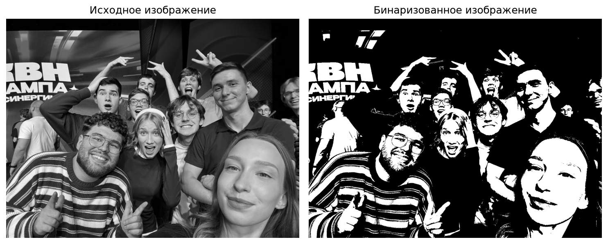
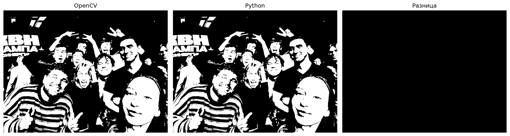
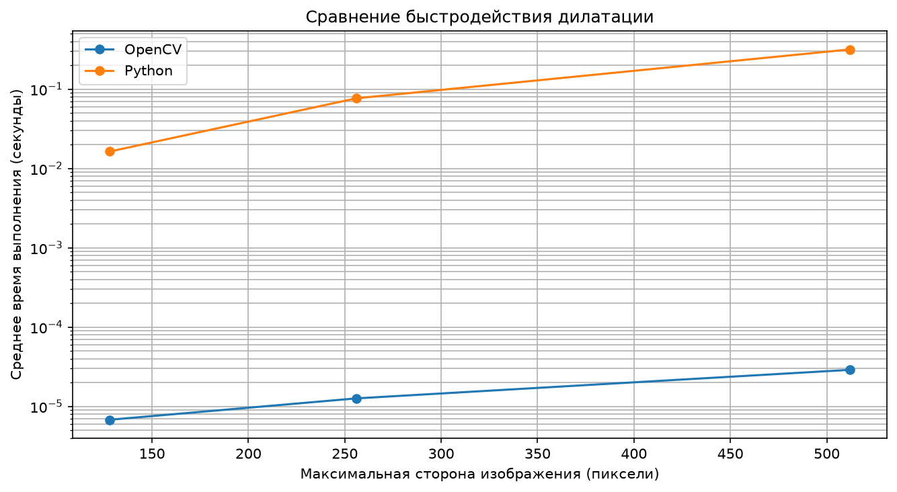

# Лабораторная работа №1. Дилатация изображения

## 1. Цель работы

Изучить принципы морфологической обработки изображений и реализовать алгоритм дилатации двумя способами:
- С использованием библиотеки OpenCV.
- Самостоятельно на языке Python.

Дополнительная задача — сравнить корректность и быстродействие двух реализаций на изображениях различного размера.

## 2. Теоретическая база

### 2.1. Дилатация

Дилатация (расширение) — это морфологическая операция обработки изображений, которая увеличивает размеры светлых объектов на изображении.

Основные задачи дилатации:
- Расширение границ объектов.
- Заполнение небольших промежутков.
- Соединение близко расположенных областей.

Данная операция применяется при обработке изображений, распознавании объектов и предварительной подготовке изображений для дальнейшего анализа.

### 2.2. Структурный элемент

Для выполнения дилатации используется структурный элемент (ядро), который определяет область соседних пикселей, участвующих в обработке.

В данной лабораторной работе используется структурный элемент размером 3×3:

```text
1 1 1
1 1 1
1 1 1
```

Для бинарного изображения применяются следующие правила:

1. Если хотя бы один пиксель в области 3×3 является белым (значение 255), центральный пиксель становится белым.
2. Если все пиксели в области 3×3 являются чёрными (значение 0), центральный пиксель остаётся чёрным.

Таким образом, белые области изображения постепенно расширяются.

### 2.3. Бинаризация изображения

Перед выполнением дилатации исходное изображение переводится в чёрно-белый формат.

Для этого используется бинаризация с порогом 127:
- Пиксели со значением яркости больше 127 становятся белыми (255).
- Пиксели со значением яркости 127 и меньше становятся чёрными (0).

Бинаризация выполняется с помощью функции `cv2.threshold()` из библиотеки OpenCV.

Самостоятельная реализация бинаризации в данной работе не требуется.

## 3. Используемые технологии

| Технология       | Назначение                                    |
| ---------------- | --------------------------------------------- |
| Python 3.11      | Основной язык программирования                |
| OpenCV           | Загрузка, бинаризация и обработка изображений |
| NumPy            | Работа с массивами пикселей                   |
| Matplotlib       | Отображение изображений и построение графиков |
| Jupyter Notebook | Разработка и выполнение программы             |

## 4. Структура проекта

```text
lab1/
│
├── photos/
│   └── original.png
│
├── results/
│   ├── binary.png
│   ├── opencv_result.png
│   ├── python_result.png
│   ├── input_and_binary.png
│   ├── dilation_comparison.png
│   └── performance.png
│
├── lab1.ipynb
└── README.md
```

## 5. Описание реализации

Программа состоит из следующих этапов:

1. Загрузка исходного изображения.
2. Преобразование изображения в оттенки серого.
3. Бинаризация изображения.
4. Выполнение дилатации с помощью OpenCV.
5. Самостоятельная реализация дилатации на Python.
6. Сравнение результатов двух алгоритмов.
7. Измерение времени выполнения и построение графика.

### 5.1. Реализация с использованием OpenCV

Для реализации дилатации с помощью OpenCV используется функция `cv2.dilate()`.

Сначала создаётся структурный элемент размером 3×3:

```python
kernel = np.ones((3, 3), dtype=np.uint8)
```

Затем выполняется обработка изображения:

```python
result = cv2.dilate(
    img,
    kernel,
    iterations=1
)
```

Функция принимает исходное изображение, структурный элемент и количество повторений операции.

### 5.2. Самостоятельная реализация на Python

Вторая реализация алгоритма написана самостоятельно без использования готовой функции дилатации из OpenCV.

Для обработки изображения используются вложенные циклы `for`.

Основные этапы алгоритма:

1. Получение размеров исходного изображения.
2. Создание дополнительной рамки из чёрных пикселей для корректной обработки границ изображения.
3. Последовательный перебор всех пикселей изображения.
4. Проверка соседних пикселей в области 3×3.
5. Если среди соседей обнаруживается хотя бы один белый пиксель, соответствующий пиксель результата становится белым.
6. Сохранение полученного изображения.

Для хранения изображения и промежуточных результатов используется NumPy.

### 5.3. Проверка корректности реализаций

Для проверки правильности самостоятельной реализации результаты двух алгоритмов сравниваются с помощью функции `np.array_equal()`.

Дополнительно используется функция `cv2.absdiff()`, которая позволяет получить изображение разницы между двумя результатами.

Количество различающихся пикселей определяется с помощью `np.count_nonzero()`.

Если результаты совпадают, количество различающихся пикселей должно быть равно нулю.

## 6. Результаты работы

### 6.1. Исходное и бинаризованное изображения

В качестве исходных данных использовалась фотография размером 1280×960 пикселей.

Сначала изображение было преобразовано в оттенки серого, после чего выполнена бинаризация с порогом 127.



### 6.2. Результаты дилатации

К бинаризованному изображению была применена операция дилатации с использованием структурного элемента 3×3.

Для проверки корректности самостоятельной реализации результаты двух алгоритмов были сравнены.

Результат проверки:

```text
Результаты совпадают!
Количество различающихся пикселей: 0
```

Это подтверждает, что обе реализации сформировали идентичные изображения на использованном тестовом примере.



### 6.3. Сравнение быстродействия

Для сравнения производительности использовались изображения трёх размеров.

Исходное изображение масштабировалось с сохранением пропорций. Максимальная сторона составляла 128, 256 и 512 пикселей соответственно.

Для измерения времени использовалась функция `perf_counter()`.

Перед измерением выполнялся предварительный запуск алгоритма. Затем измерялось суммарное время нескольких выполнений, после чего рассчитывалось среднее время одного выполнения.

Количество повторений:
- OpenCV — 1000.
- Самостоятельная реализация Python — 10.

Результаты измерений:

| Максимальная сторона изображения | Размер изображения | OpenCV (сек.) | Python (сек.) |
| -------------------------------- | ------------------ | ------------: | ------------: |
| 128                              | 128×96             |      0.000007 |      0.015423 |
| 256                              | 256×192            |      0.000011 |      0.073156 |
| 512                              | 512×384            |      0.000027 |      0.304895 |

Значения времени OpenCV приведены с округлением до шести знаков после запятой.

График сравнения быстродействия:



### 6.4. Анализ результатов

По результатам эксперимента можно сделать следующие наблюдения:

1. Реализация OpenCV выполняется значительно быстрее самостоятельной реализации на Python.
2. При увеличении размера изображения время выполнения обеих реализаций увеличивается.
3. Самостоятельная реализация показывает увеличение времени, приблизительно пропорциональное количеству обрабатываемых пикселей.
4. Разница в быстродействии объясняется тем, что OpenCV использует оптимизированные реализации операций обработки изображений, тогда как самостоятельная реализация выполняет перебор пикселей с помощью вложенных циклов Python.

Временная сложность самостоятельной реализации составляет:

\[
O(H \cdot W)
\]

где:
- \(H\) — высота изображения;
- \(W\) — ширина изображения.

Это связано с тем, что каждый пиксель обрабатывается один раз, а количество проверяемых соседей постоянно и равно девяти.

## 7. Выводы

В ходе лабораторной работы был изучен и реализован алгоритм морфологической обработки изображений — дилатация.

Были разработаны две реализации алгоритма: с использованием библиотеки OpenCV и самостоятельно на языке Python.

В процессе тестирования было установлено, что результаты обеих реализаций полностью совпадают. Количество различающихся пикселей составило 0, что подтверждает корректность самостоятельной реализации на проверенном изображении.

Также было проведено сравнение быстродействия алгоритмов на изображениях различного размера.

Эксперимент показал, что реализация OpenCV значительно превосходит самостоятельную реализацию по скорости выполнения. Это объясняется использованием оптимизированных алгоритмов библиотеки и выполнением самостоятельной обработки с помощью вложенных циклов Python.

В результате работы были изучены основные принципы дилатации, получены практические навыки обработки изображений с помощью OpenCV и NumPy, а также освоены методы измерения и сравнения производительности программных алгоритмов.

---

**Исходный код:** [lab1.ipynb](lab1.ipynb)