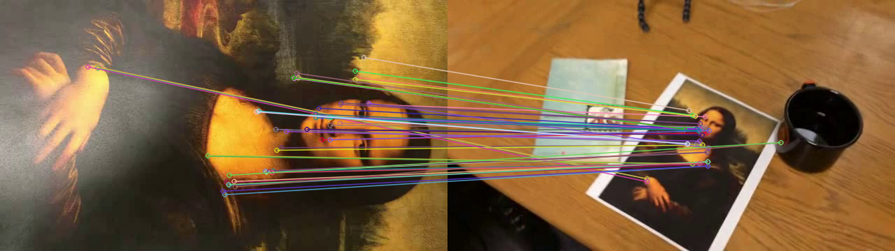
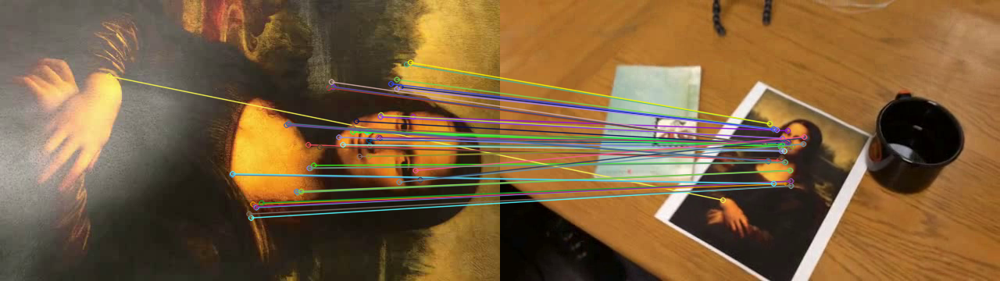
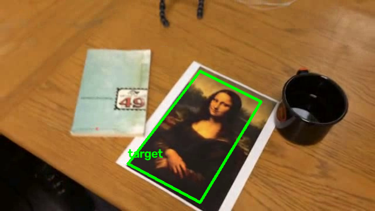

# Лабораторная работа №2 --- Отслеживание объекта на видео

## Описание

В этой лабораторной работе реализовано отслеживание объекта на видео с
помощью методов компьютерного зрения и библиотеки **OpenCV**.

Программа использует первый кадр каждого видео в качестве эталонного
изображения, определяет его ключевые точки и затем отслеживает их
перемещение на последующих кадрах. Для повышения устойчивости объединены
несколько методов:

-   **ORB** --- поиск ключевых точек и вычисление их дескрипторов;
-   **BFMatcher** --- сопоставление дескрипторов;
-   **Ratio Test** --- отбрасывание неоднозначных совпадений;
-   **Lucas--Kanade Optical Flow** --- отслеживание перемещения ключевых
    точек между соседними кадрами;
-   **Forward-Backward Check** --- дополнительная проверка качества
    отслеживания точек;
-   **RANSAC** --- отбрасывание ошибочных соответствий и вычисление
    матрицы гомографии;
-   **Homography** --- определение положения и перспективы эталонного
    изображения на текущем кадре.

На найденном объекте рисуется зелёная рамка и подпись `target`.

## Возможности

-   Автоматический поиск видео в папке `videos`.
-   Обработка всех найденных видео за один запуск.
-   Поддержка нескольких форматов: AVI, MP4, MOV, MKV, WMV, MPEG, MPG и
    M4V.
-   Отслеживание ключевых точек между соседними кадрами с помощью
    Lucas--Kanade.
-   Повторное обнаружение объекта с помощью ORB, если оптический поток
    теряет объект, а также периодически во время обработки.
-   Добавление новых ключевых точек внутри найденной области.
-   Проверка соответствий с помощью RANSAC и геометрических ограничений.
-   Автоматическое сохранение обработанных видео и статистики.

## Структура проекта

``` text
lab2/
│
├── videos/                 # Исходные видео
│   ├── video1.avi
│   ├── video2.mp4
│   └── video3.mov
│
├── results/                # Результаты работы программы
│   ├── *_tracking.avi
│   ├── *_preview.png
│   ├── feature_matching.png
│   ├── ransac_matches.png
│   └── tracking_result.png
│
├── lab2.ipynb              # Jupyter Notebook с реализацией
└── README.md
```

Папка `results` создаётся автоматически, если её ещё нет. Исходные видео
нужно положить непосредственно в папку `videos` --- вложенные папки
программа не сканирует.

## Используемые технологии

-   Python 3.11
-   OpenCV (`opencv-python`)
-   NumPy
-   Matplotlib
-   Jupyter Notebook
-   Visual Studio Code

## Установка и запуск

### 1. Создание виртуального окружения

Если виртуальное окружение `.venv` ещё не создано, выполни команды из
корневой папки репозитория:

``` powershell
python -m venv .venv
```

Активируй окружение:

``` powershell
.\.venv\Scripts\Activate.ps1
```

Если `.venv` уже существует, повторно создавать его не нужно.

### 2. Установка библиотек

В активированном виртуальном окружении выполни:

``` powershell
python -m pip install --upgrade pip
python -m pip install opencv-python numpy matplotlib ipykernel
```

### 3. Подготовка видео

Помести исходные видео в папку `lab2/videos`.

Программа автоматически распознаёт файлы со следующими расширениями:

`.avi`, `.mp4`, `.mov`, `.mkv`, `.wmv`, `.mpeg`, `.mpg`, `.m4v`.

Названия файлов менять не требуется.

### 4. Запуск ноутбука

1.  Открой папку `lab2` в Visual Studio Code.
2.  Открой файл `lab2.ipynb`.
3.  Выбери Python-интерпретатор из виртуального окружения `.venv` и
    соответствующее Jupyter-ядро.
4.  Запусти все ячейки последовательно сверху вниз.

Важно: ноутбук использует относительные пути `videos` и `results`,
поэтому рабочей директорией при запуске должна быть папка `lab2`.

## Как работает алгоритм

### 1. Подготовка эталонного кадра

Первый кадр видео переводится в оттенки серого. С помощью ORB находятся
ключевые точки и вычисляются их дескрипторы. Координаты точек
сохраняются для дальнейшего отслеживания.

### 2. Отслеживание Lucas--Kanade

Для каждого следующего кадра `cv2.calcOpticalFlowPyrLK()` оценивает
перемещение ключевых точек с предыдущего кадра на текущий.

Затем выполняется обратное отслеживание --- Forward-Backward Check.
Точки, которые не вернулись достаточно близко к исходным координатам,
отбрасываются.

### 3. Проверка с помощью RANSAC

По соответствующим точкам вычисляется матрица гомографии. RANSAC
помогает исключить ошибочные соответствия. Дополнительно проверяются
количество правильных точек, их распределение и геометрия полученной
рамки.

### 4. Повторное обнаружение ORB

Каждые 10 кадров или при потере объекта программа повторно запускает ORB
и сопоставляет дескрипторы текущего кадра с эталонными с помощью
BFMatcher и Ratio Test.

Это позволяет восстановить отслеживание, если Lucas--Kanade потерял
часть ключевых точек.

### 5. Добавление новых точек

Во время обработки программа периодически ищет дополнительные ключевые
точки внутри найденной области. Это помогает поддерживать достаточное
количество точек для дальнейшего отслеживания.

### 6. Построение рамки и сохранение результата

С помощью матрицы гомографии координаты углов эталонного кадра
переносятся на текущий кадр. Вокруг найденной области рисуется зелёная
рамка с подписью `target`.

Обработанные кадры записываются в новое видео.

## Результаты

Для каждого исходного видео создаётся отдельный файл в папке `results`.

Имя выходного файла формируется автоматически:

``` text
<имя_исходного_видео>_tracking.avi
```

Например, для `sample.mp4` результат будет сохранён как
`sample_tracking.avi`.

После обработки ноутбук выводит статистику по каждому видео:

-   общее количество кадров;
-   количество кадров, в которых объект удалось обнаружить;
-   процент успешного обнаружения;
-   количество обнаружений с помощью Lucas--Kanade;
-   количество повторных обнаружений с помощью ORB;
-   количество кадров, в которых объект не был найден.

Также формируется общая таблица результатов по всем обработанным видео.

## Примеры визуализации

После выполнения демонстрационных ячеек ноутбук сохраняет изображения
сопоставления ключевых точек и результат построения рамки. Если эти
изображения добавлены в репозиторий, GitHub покажет их прямо в README.

### Сопоставление ключевых точек



### Совпадения после фильтрации RANSAC



### Результат определения положения объекта



## Важные замечания

-   В текущей реализации **первый кадр целиком используется как
    эталонная область**. Программа не предлагает вручную выбрать
    произвольный объект внутри кадра.
-   Алгоритм рассчитан на отслеживание сцены или объекта, который можно
    сопоставить с эталонным изображением по ключевым точкам и
    перспективному преобразованию.
-   Процент успешного обнаружения зависит от конкретного видео, качества
    изображения, размытия, освещения и изменения масштаба.
-   Если объект временно не удаётся надёжно определить, в
    соответствующем кадре появляется надпись `Object not found`.

## Автор

Лабораторная работа выполнена с использованием Python и OpenCV.
